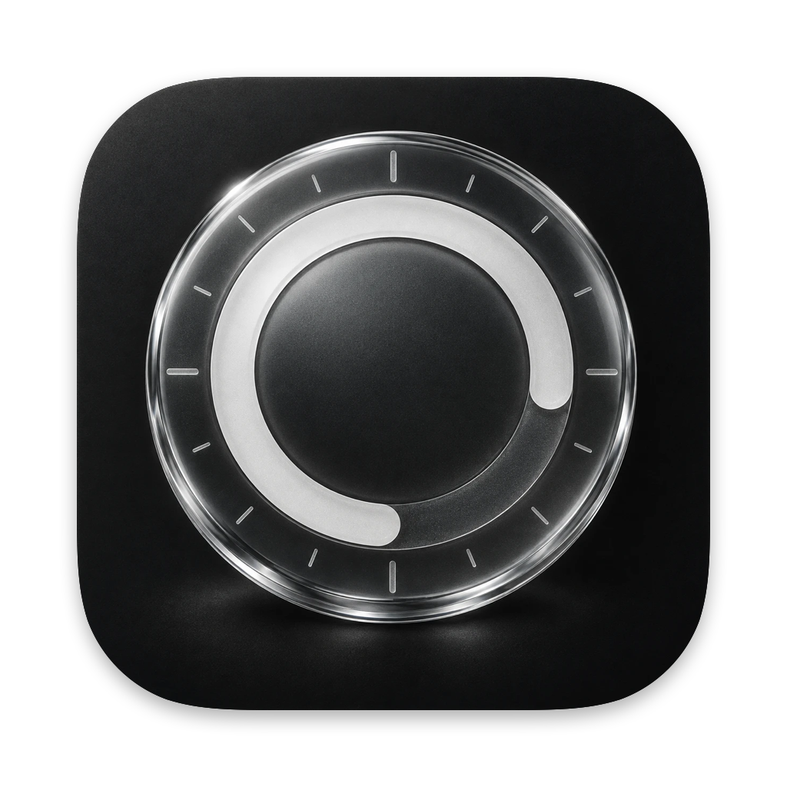
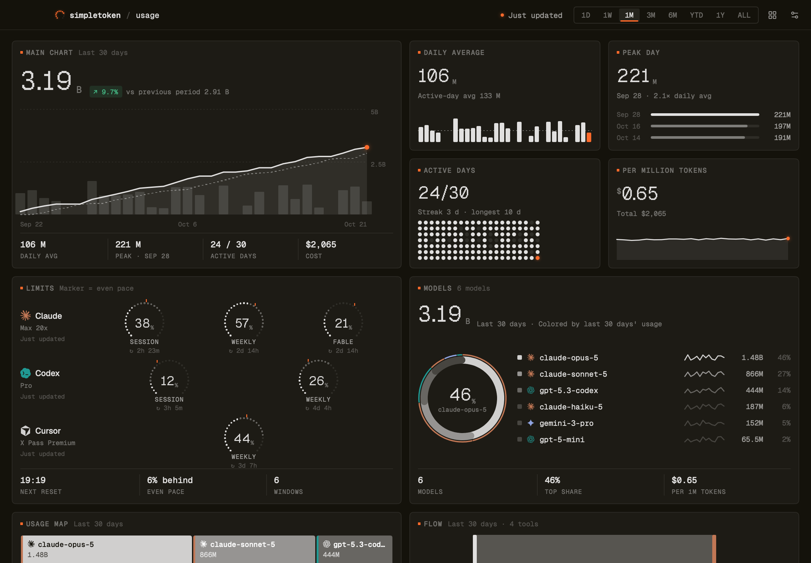
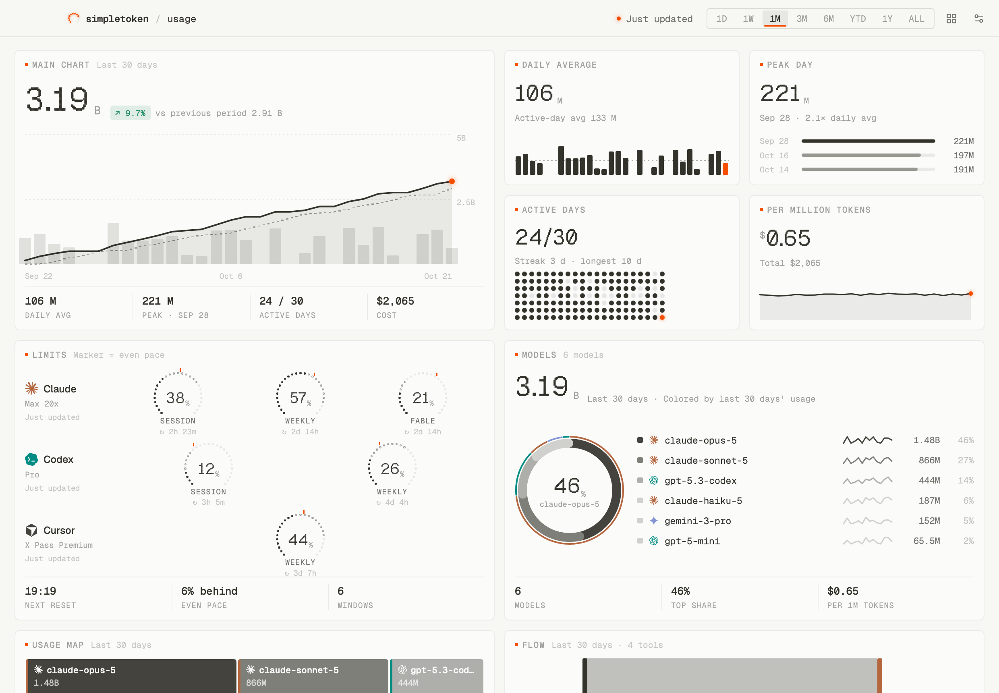
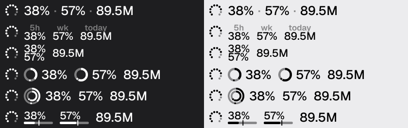
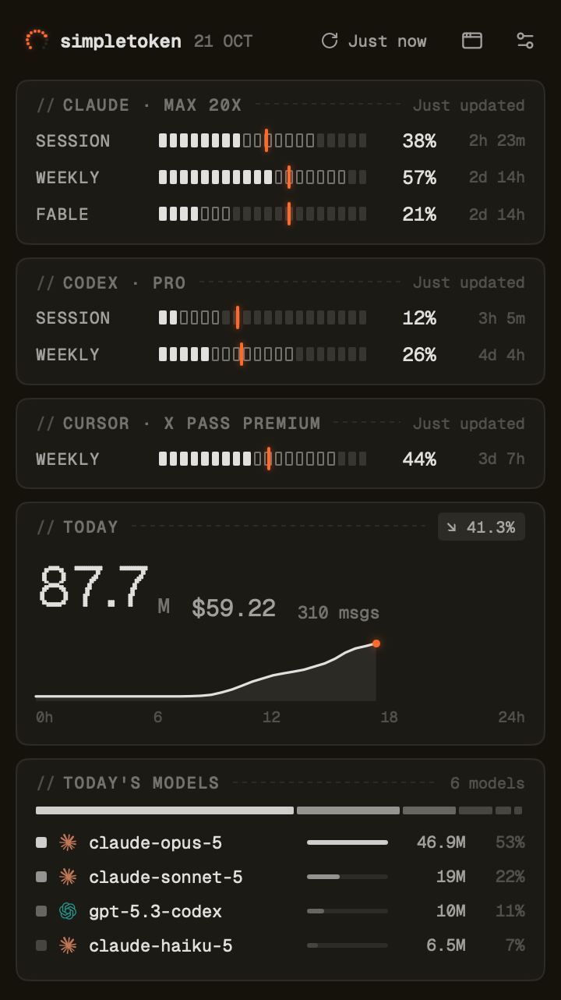
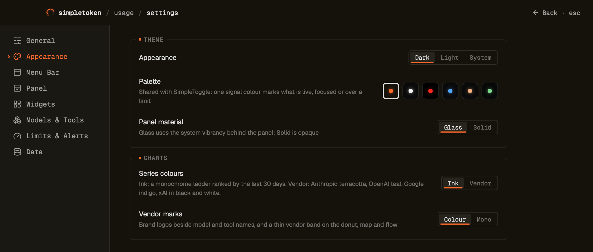

<div align="center">



# SimpleToken

**A native macOS menu-bar app and dashboard for your AI coding usage.**
Tokens, cost and plan limits for Claude Code and Codex, all computed on your Mac.




</div>

## Why SimpleToken

Claude Code and Codex are billed by plan limits that reset every few hours and every week, and the per-token cost is invisible. SimpleToken reads the logs your tools already write, keeps a local history, and shows you where your usage goes: how fast you are burning through the current window, which models do the work, when you work, and what it would have cost at list prices.

- **Native and light.** Written in Go on [mygo](https://github.com/egoist/mygo)'s native UI, with no web view: under 40 MB of memory in the menu bar, under 100 MB with the window open, and near-zero CPU when idle. Nothing is drawn while nothing is visible.
- **Private by design.** Usage is computed from local logs. The only network request is the plan-limit check against claude.ai, using a cookie you provide.
- **Yours to arrange.** Every chart is a widget you can drag, resize and configure, in a dark or light theme with six palettes.

## Features

### A dashboard of widgets

Every chart and stat is a widget in one of four sizes: small (1×1), medium (2×1), large (2×2) or wide (4×2). Each size has its own layout, from a single number with a sparkline to a full chart with a row of key facts. The grid adds columns as the window gets wider while widgets keep roughly the same size. Drag a widget to move it, right-click to resize it, or flip it over to change its options and colour.

<p align="center">
  
</p>

Widgets include:

| Widget | What it shows |
| --- | --- |
| Main chart | Cumulative usage for the selected range against the previous period (or the same period last year) |
| Limits | Claude session, weekly and model windows, Codex windows, the Cursor / Grok Bot weekly window, pace markers and a projection to the reset |
| Models | Share by model with vendor colours and logos, daily trends and cost per million tokens |
| Usage map | A treemap of your models, grouped by vendor and sized by usage |
| Flow | A flow diagram from tools to the models they used |
| Usage chart | Stacked bars by model or tool, or half-hour bars for a single day with day-by-day navigation |
| Calendar | A heatmap of daily usage with streaks and your busiest day |
| Time of day | A weekday × hour punchcard of when you work |
| Tools | Usage per tool (Claude Code, Codex, Grok Bot, Cursor, Copilot, OpenCode, Gemini) |
| Token breakdown | Cache reads and writes, fresh input and output, and your cache hit rate |
| This month's cost | Month-to-date cost at list prices, a month-end projection and last month for reference |
| Stats | Eight single-number widgets: daily average, peak day, active days, cost per million tokens, total cost, messages, top model and busiest weekday |

Charts are drawn with a shared kit of thin marks and dot-matrix numbers that animate when you switch the range or metric. Series are an ink ladder ranked by the last 30 days, with vendor logos beside the names; switch to vendor colours (Anthropic terracotta, OpenAI teal, Google indigo) in Settings → Appearance. Hover over any of them for details: a day's model and tool breakdown, a half-hour slot, a calendar day ranked against the rest, a punchcard cell with its model mix, or a tool's share of a model. Time ranges run from 1D to ALL.

### Menu bar

Show any mix of Claude, Codex and Cursor limits, today's tokens or cost, this month's cost, the session reset countdown, and small charts of today by hour and the last seven days. Six styles fit them into the menu bar: one line, two lines, compact (two rows), rings, nested rings in the spirit of Activity, and progress bars. Rings and bars mark where even use would be by now. Values turn red near the limit.

<p align="center">
  
</p>

### Drop-down panel

Click the menu-bar item for a compact panel: plan limits, today's usage with a hoverable trend and a comparison with the same time yesterday, today's models and tools, the last seven days and month-to-date cost. Choose the sections, their order and the panel width.

<p align="center">
  
</p>

### Alerts and settings

Optional notifications when a limit crosses thresholds you choose. Settings cover the theme and palette, model and tool colours, aliases, which models and tools count towards the totals, refresh intervals, launch at login and automatic updates.

<p align="center">
  
</p>

## Install

Download `SimpleToken-<version>.dmg` from [Releases](https://github.com/HanlunWang/SimpleToken/releases), open it and drag `SimpleToken.app` to `/Applications`. It needs macOS 14 or later on Apple silicon. Releases are signed with a Developer ID and notarized by Apple, so the app opens without a warning. From then on the app updates itself (Settings → General); updates are signed and verified before they are installed.

Coming from 0.1.x? Install over it: your history, settings and claude.ai key carry over.

SimpleToken lives in the menu bar. Click its icon for the panel, or ⌥-click for the main window.

## Getting your usage in

SimpleToken never asks you to sign in to it. It reads what your coding tools already record on this Mac, so there are two separate things to set up.

**1. Usage (tokens, cost, models, tools): nothing to configure.** Keep using your tools on this Mac while signed in to them as usual. SimpleToken picks up their local logs automatically:

| Tool | What to do |
| --- | --- |
| Claude Code | Sign in once with `claude` (Claude subscription or API key). Sessions are logged to `~/.claude/projects`. |
| Codex (CLI or app) | Sign in once with `codex login` or in the Codex / ChatGPT app. Sessions are logged under `~/.codex`. |
| Grok Bot, Cursor | Sign in to the Cursor desktop app on this Mac. Their usage is not logged locally: SimpleToken syncs it from your Cursor account (through tokscale), once an hour. Grok Bot shows up as its own tool. |
| GitHub Copilot CLI, OpenCode, Gemini CLI | Use them as usual; their local logs are read if present. |

A model shows up as soon as a tool has logged a request with it, grouped by vendor (Anthropic, OpenAI, Google, xAI and others). Nothing appears for tools you haven't used on this Mac. Half-hour (1D) detail is available for Claude Code only.

**2. Plan limits (optional).**

- **Claude:** limits come from claude.ai. Sign in to claude.ai in your browser, open Developer Tools → Application → Cookies → `https://claude.ai`, copy the value of `sessionKey` (it starts with `sk-ant-`) and paste it into Settings → Limits & Alerts. It is stored only on this Mac, in a file only your user can read. If limits stop updating after you sign out of claude.ai, paste a fresh value. The plan name (for example Max 20x) is read from Claude Code's keychain item, so macOS may ask once whether SimpleToken can read "Claude Code-credentials".
- **Codex:** nothing to paste. SimpleToken asks the local `codex app-server` (read-only, no approvals), which uses your existing Codex sign-in. It finds `codex` inside Codex.app or ChatGPT.app, in `~/.local/bin`, or in Homebrew.
- **Cursor / Grok Bot (X Pass):** nothing to paste either. The weekly included-usage window that Grok Bot and Cursor share, and any on-demand spend limit, are read from your Cursor account with the Cursor desktop app's sign-in.

## Build from source

Requirements: macOS 14 or later on Apple silicon, [Go](https://go.dev) (the version in `go.mod`; with `GOTOOLCHAIN=auto` an older Go fetches it) and the Xcode command line tools. No cgo: mygo talks to AppKit and Metal directly.

```bash
git clone https://github.com/HanlunWang/SimpleToken.git
cd SimpleToken
go tool mygo build -skip-dmg -sign -
open build/mygo/darwin-arm64/SimpleToken.app
```

`-sign -` signs ad-hoc, which is enough to run the app on the Mac that built it. Run the tests with `go test ./...`; `SIMPLETOKEN_SHOTS=<dir> go test ./gui/` also writes headless renders of the window, panel, settings and menu bar. Releases are built, signed and notarized by GitHub Actions when a version tag is pushed; see [docs/RELEASING.md](docs/RELEASING.md).

## Where the data comes from

| Data | Source |
| --- | --- |
| Daily tokens, cost, models and tools | The bundled [tokscale](https://github.com/junhoyeo/tokscale) CLI, which scans the local logs of Claude Code, Codex, Copilot, OpenCode and Gemini |
| Half-hour usage | Claude Code session logs in `~/.claude/projects` (only timestamps, model ids and token counts are read, never conversation content) |
| Claude plan limits | The claude.ai usage endpoint, with your `sessionKey` cookie |
| Claude plan name | The subscription tier from Claude Code's keychain item (the token itself is not read) |
| Codex plan limits | The local `codex app-server` (read-only, no approvals) |
| Grok Bot and Cursor usage | Your Cursor account's usage API, synced into tokscale's cache with the Cursor desktop app's sign-in |
| Cursor plan limits | Cursor's dashboard API (the weekly window and the on-demand spend), with the same sign-in |

Everything else stays in `~/Library/Application Support/SimpleToken/`. Costs are estimates at public list prices; subscription plans are billed differently.

## Languages

The interface is available in English and Simplified Chinese and follows your macOS language. Translations live in [`gui/i18n/Localizable.xcstrings`](gui/i18n/Localizable.xcstrings); new languages are welcome.

## Project layout

```
cmd/simpletoken/     entry point
internal/            collection, analytics, limits, persistence, settings (no UI)
gui/                 widgets, dashboard, settings, panel, menu bar, fonts, icons, translations
Resources/tokscale/  bundled tokscale binary
designs/logo/        icon sources
docs/                architecture notes and screenshots
mygo.json            app name, version, bundle id, signing and update settings
App/, SimpleTokenKit/, project.yml   the Swift 0.1.x app, kept until v2 ships
```

Contributor notes are in [AGENTS.md](AGENTS.md) and [docs/ARCHITECTURE.md](docs/ARCHITECTURE.md). To take screenshots or demo the app without your own data, launch it with `SIMPLETOKEN_DEMO=1` (synthetic data; nothing is read or written). The README images come from `SIMPLETOKEN_README_IMAGES=docs/images go test ./gui/ -run TestReadmeImages`.

## Acknowledgements

- [tokscale](https://github.com/junhoyeo/tokscale) by Junho Yeo, which does the heavy lifting of reading agent logs (MIT)
- [mygo](https://github.com/egoist/mygo), the native UI framework the app is built on (MIT)
- [Geist](https://vercel.com/font) fonts (OFL) and [Lucide](https://lucide.dev) icons (ISC)
- Brand logos from [AI Logo](https://github.com/yldm-tech/ai-logo), a fork of LobeHub's lobe-icons (MIT)

See [THIRD_PARTY_NOTICES.md](THIRD_PARTY_NOTICES.md).

## License

[MIT](LICENSE). SimpleToken is an independent project and is not affiliated with or endorsed by Anthropic, OpenAI, GitHub or Google. Product names and logos belong to their owners.
